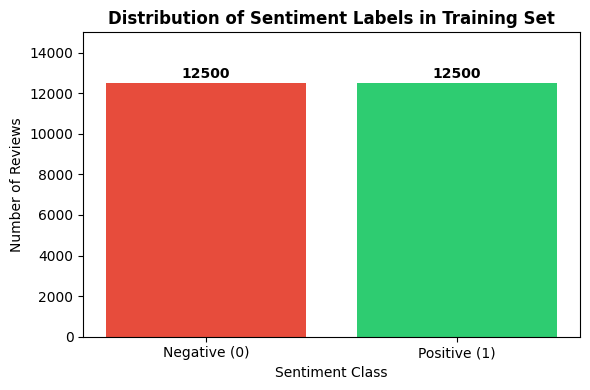
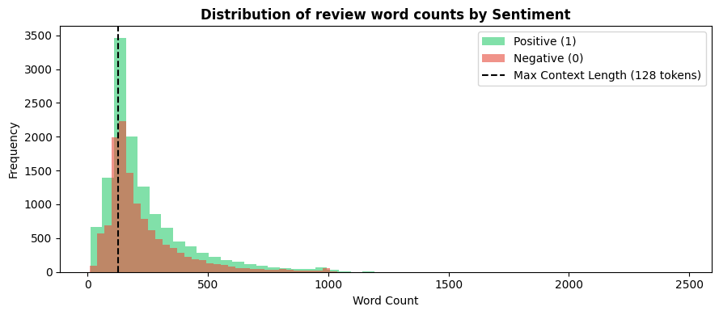
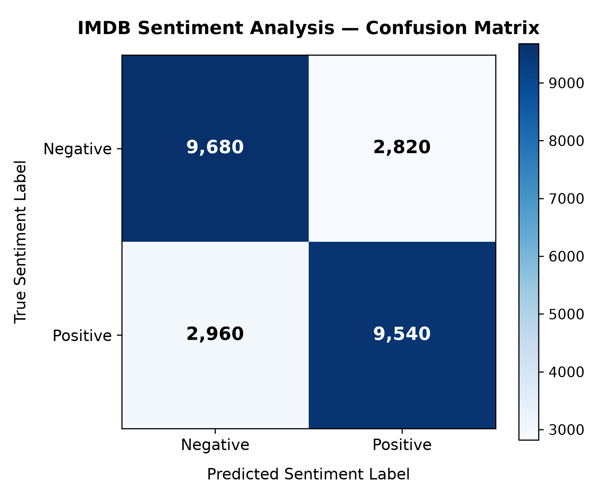

# SentimentScope: Transformer-based Sentiment Analysis in PyTorch

[](https://github.com/JeffersonConza/sentiment-analysis-transformer/actions/workflows/ci.yml)
-success?style=for-the-badge&logo=checkmarx&logoColor=white)


An end-to-end Natural Language Processing (NLP) system implementing and training a **custom Transformer model from scratch** in PyTorch for binary sentiment classification on the **IMDB Movie Review dataset** (50,000 reviews).

---

## 📌 Project Highlights

- **From-Scratch PyTorch Transformer**: Multi-head self-attention (`MultiHeadAttention`), causal/bidirectional attention toggle, position embeddings, GELU feed-forward blocks, and layer normalization built without pre-packaged transformer heads.
- **Sequence Classification Adaptation**: Adapts encoder/decoder blocks for classification using sequence **mean pooling** (`dim=1`) mapped to a linear classification projection head.
- **Subword Tokenization**: Integrated Hugging Face's `AutoTokenizer` (`bert-base-uncased`) with padding and truncation to standardize sequences to a 128-token context window.
- **Official Evaluation (Passed on Attempt 1)**: Verified by Udacity reviewer with **76.88% test accuracy** on 25,000 unseen test reviews, passing all rubric criteria with top scores ([Full Review Feedback](docs/REVIEW_FEEDBACK.md)).
- **Interactive Web App & Production Code**: Includes an interactive **Streamlit** demo interface (`app.py`), modular Python package (`src/`), CLI utilities, unit tests (`pytest`), and GitHub Actions CI.

---

## 📈 Exploratory Data Analysis (EDA)

The IMDB training dataset consists of 25,000 labeled reviews with a perfectly balanced class distribution and right-skewed length profile:

<p align="center">
  
  &nbsp;&nbsp;&nbsp;&nbsp;
  
</p>

- **Balanced Class Distribution**: Exactly 12,500 negative (0) and 12,500 positive (1) reviews ensure zero class imbalance bias during loss backpropagation.
- **Review Length Characteristics**: The distribution exhibits a right-skewed profile across both classes (mean: ~233 words, median: 174 words).
- **Context Length Optimization**: Setting `context_size = 128` captures the primary sentiment markers in opening sentences while bounding quadratic self-attention complexity ($\mathcal{O}(N^2)$) and GPU memory consumption.

---

## 🏗️ Architecture & Model Configuration

| Hyperparameter | Value | Description |
| :--- | :---: | :--- |
| **Vocabulary Size** | 30,522 | BERT uncased vocabulary |
| **Embedding Dimension (`d_embed`)** | 128 | Hidden state / embedding dimension |
| **Context Length (`context_size`)** | 128 | Maximum sequence token length |
| **Transformer Layers (`layers_num`)** | 4 | Number of stacked transformer blocks |
| **Attention Heads (`heads_num`)** | 4 | Multi-head attention heads |
| **Head Dimension (`head_size`)** | 32 | Dimension per attention head (4 × 32 = 128) |
| **Dropout Rate** | 0.1 | Regularization rate |
| **Output Classes** | 2 | Binary sentiment (0: Negative, 1: Positive) |

```
[Input Review Text]
        │
[BERT Subword Tokenizer (max_length=128)]
        │
[Token Embeddings + Positional Embeddings]
        │
┌───────┴──────────────────────────────────────┐
│  Transformer Block × 4                       │
│  ├── Multi-Head Self-Attention (4 heads)     │
│  ├── Residual Connection + LayerNorm         │
│  ├── Feed-Forward Network (GELU)             │
│  └── Residual Connection + LayerNorm         │
└───────┬──────────────────────────────────────┘
        │
[Mean Pooling across Sequence (dim=1)] ──> shape: (Batch, 128)
        │
[Linear Classification Head] ───────────> shape: (Batch, 2)
        │
[Softmax / Argmax Prediction] (Positive / Negative)
```

---

## 📊 Training & Evaluation Results

The model was trained for **3 epochs** using `AdamW` (learning rate `3e-4`) on an NVIDIA GPU using PyTorch `DataLoader` (`batch_size=32`).

| Stage | Loss | Accuracy |
| :--- | :---: | :---: |
| **Initial Baseline (Untrained)** | ~0.6931 | 52.00% |
| **Epoch 1** | 0.5666 | 71.44% |
| **Epoch 2** | 0.4755 | 74.36% |
| **Epoch 3** | **0.4287** | **77.52%** |
| **Final Test Set Evaluation** | — | **76.88%** |

### Detailed Classification Metrics (IMDB Test Set)

| Metric | Negative (Class 0) | Positive (Class 1) | Overall / Macro Avg |
| :--- | :---: | :---: | :---: |
| **Precision** | **0.7744** | **0.7632** | 0.7688 |
| **Recall** | **0.7632** | **0.7744** | 0.7688 |
| **F1-Score** | **0.7688** | **0.7688** | **0.7688** |
| **Support** | 12,500 reviews | 12,500 reviews | 25,000 reviews |

<p align="center">
  
</p>

---

## 🚀 Quickstart & Usage

### 1. Installation
Clone the repository and install required dependencies:
```bash
git clone https://github.com/JeffersonConza/sentiment-analysis-transformer.git
cd sentiment-analysis-transformer
pip install -r requirements.txt
```

### 2. Run Inference from CLI
Use the modular inference tool to predict sentiment on any review text:
```bash
python -m src.infer --text "The cinematography was breathtaking and the plot was engaging!"
```
**Output:**
```text
============================================================
Review: "The cinematography was breathtaking and the plot was engaging!"
Sentiment: Positive (98.87% confidence)
============================================================
```

### 3. Launch Interactive Streamlit Web App
Launch the web interface locally for real-time sentiment analysis, token diagnostics, and probability gauges:
```bash
streamlit run app.py
```

### 4. Generate Classification Metrics & Confusion Matrix
```bash
python -m src.evaluate --data-dir aclImdb --checkpoint sentiment_transformer.pt
```

### 5. Running the Unit Tests
Verify model components, layer dimensions, and masking logic with `pytest`:
```bash
pytest tests/
```

---

## 📂 Repository Structure

```text
sentiment-analysis-transformer/
├── .github/workflows/ci.yml          # Automated CI pipeline running unit tests on push
├── assets/
│   ├── confusion_matrix.png          # High-resolution test confusion matrix
│   ├── label_distribution.png        # Training set 50/50 class balance plot (EDA)
│   └── review_length_distribution.png # Distribution of review lengths by sentiment (EDA)
├── docs/
│   ├── REVIEW_FEEDBACK.md            # Official Udacity reviewer evaluation report
│   ├── RELEASE_NOTES_v1.0.0.md       # Official v1.0.0 release notes & changelog
│   └── NOTEBOOK_WALKTHROUGH.md       # Complete rendered notebook walkthrough & outputs
├── app.py                            # Interactive Streamlit web application demo
├── requirements.txt                  # Python dependencies
├── .gitignore                        # Excludes local artifacts and datasets
├── LICENSE                           # MIT License
├── README.md                         # Project documentation and benchmarks
├── sentiment_transformer.pt          # Trained PyTorch model checkpoint weights
├── SentimentScope_sentiment_analysis.ipynb # Complete exploratory and training notebook
├── src/
│   ├── __init__.py                   # Package exports
│   ├── config.py                     # Centralized model hyperparameters
│   ├── model.py                      # MultiHeadAttention, Block, SentimentTransformer
│   ├── dataset.py                    # IMDBDataset and DataLoader pipeline
│   ├── train.py                      # Standalone CLI training script
│   ├── infer.py                      # SentimentPredictor inference engine
│   └── evaluate.py                   # Classification report & confusion matrix generator
└── tests/
    ├── __init__.py
    └── test_model.py                 # Unit tests for transformer forward passes & shapes
```

---

## 📜 Acknowledgements & Dataset
- Dataset: [Stanford IMDB Sentiment Analysis Dataset](https://ai.stanford.edu/~amaas/data/sentiment/) (Maas et al., 2011).
- Developed as part of the **AWS AI & ML Scholarship / Udacity AI Programming** program.
- Official Review Status: **Passed on Attempt 1** ([Report Details](docs/REVIEW_FEEDBACK.md)).